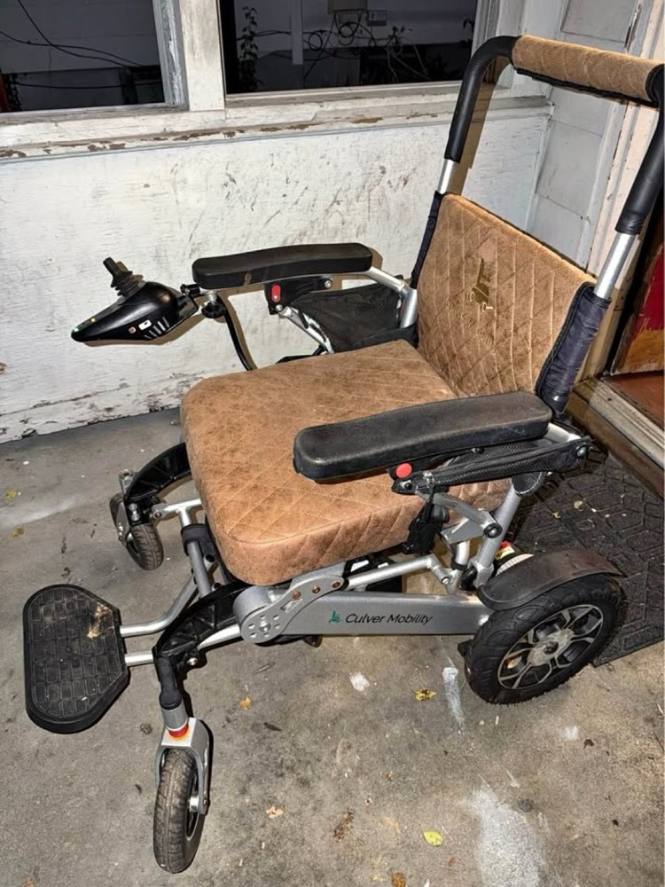
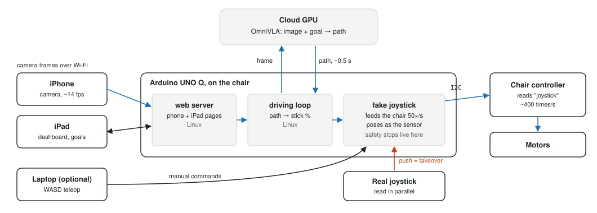
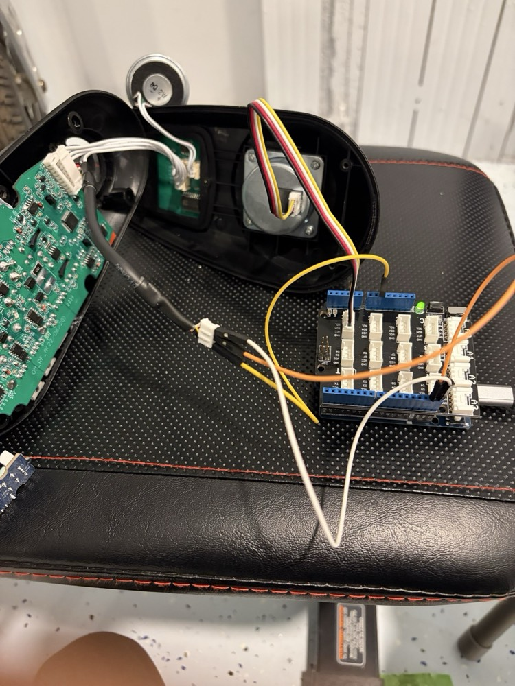
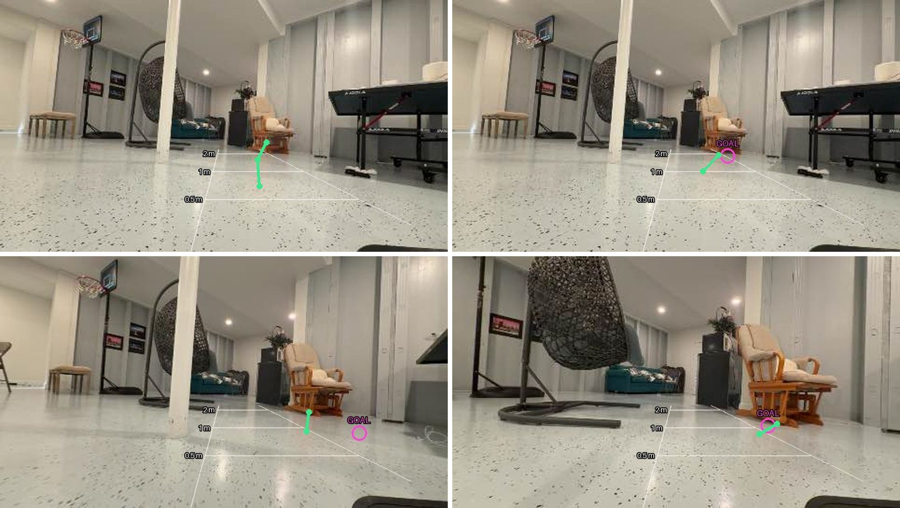

# FSD Wheelchair

A self-driving power wheelchair, made from a stock folding chair, an Arduino, an iPhone and an iPad. Built in one weekend at HackPrinceton Fall '26, for about 1% of what a comparable chair costs.

Full write-up: [Building an FSD wheelchair with a post-trained model](https://ishaikh.com/blog/fsd-wheelchair)

## What it does

Say or type where you want to go, and the chair drives there.

- **Summon:** away from the chair? Press a button and it drives to you.
- **Indoors:** "take me to the blue sofa". It finds the target and stops where it's easy to get off.
- **Outdoors:** places within half a mile, following walking routes and avoiding obstacles.

The rider can grab the real joystick at any time and take over.

## How it works

- **iPhone (eyes):** mounted on the chair, streams its camera, gyro and GPS.
- **AI (brain):** looks at the camera and the goal and decides where to drive. Runs on a cloud GPU.
- **Arduino UNO Q (hands):** pretends to be the chair's joystick, so the chair drives as if someone were pushing the stick.
- **iPad (dashboard):** pick where to go, watch the trip, take over.

## The hack: an Arduino that pretends to be a joystick

We didn't touch the motors or the chair's software. A multimeter showed the joystick wasn't a simple voltage. It turned out to be a small magnetic sensor chip that the chair asks "where is the stick?" about 400 times a second over I2C (a two-wire chip-to-chip link). We recorded that conversation, then made the Arduino answer in the sensor's place.

 

The catch: the chair speaks I2C with a timing quirk that the Arduino's built-in I2C hardware rejects, so the chair just beeped. We wrote the protocol in software instead, bit by bit, and the chair accepted it.

Nothing is cut or soldered. Plug the original cable back in and it's a stock chair again.

## How it drives

An AI model marks the goal in the camera image and sketches a short route on the floor. Our driving code does the rest:

- **Depth from one camera:** no LiDAR. A depth model, calibrated against tape marks on the floor, turns route points into real distances.
- **Smooth steering:** the chair follows gentle arcs toward the route and slows down on tight turns, for the rider's comfort.
- **Memory:** it remembers obstacles it has passed and the goal, even when the camera loses sight of it.
- **Turn checking:** the phone's gyro confirms the chair actually turned as much as asked.

*Four looks on the way to a rocking chair: the green line is the planned route, the pink ring is the goal.*

Every drive is logged and labelled, and the good ones become training data for a faster model of our own.

## Repo

| Folder | What |
|--------|------|
| [`hardware/`](hardware) | Arduino firmware, the board's control daemon, and chair setup |
| [`ml/`](ml) | The driving side: camera frame → AI → joystick command |
| [`service/`](service) | Receives the phone's camera and sensors |
| [`web/`](web) | The phone's camera page |
| [`app/`](app) | The iPad dashboard |

Setup and running: [hardware/README.md](hardware/README.md) and [ml/README.md](ml/README.md).
