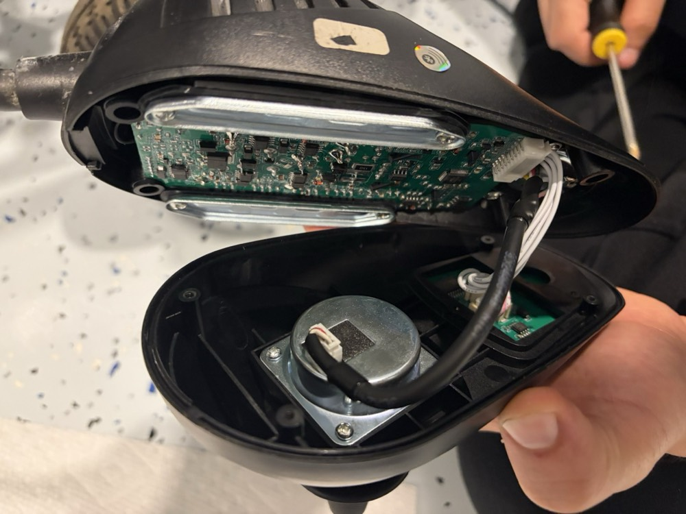
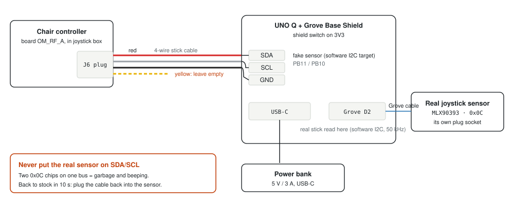

# FSD Wheelchair

A self-driving power wheelchair, made from a stock folding chair, an Arduino, an iPhone and an iPad. Built at HackPrinceton Fall '26.

## How it works

- **iPhone (eyes):** mounted on the chair, streams its camera.
- **AI (brain):** looks at the camera and the goal and decides where to drive. It runs on a cloud GPU (OmniVLA, an open robot-navigation model) or through Claude.
- **Arduino UNO Q (hands):** pretends to be the chair's joystick, so the chair drives as if someone were pushing the stick. The rider can grab the real joystick at any time and take over.
- **iPad (dashboard):** pick where to go, see what the chair sees.

## The hack: an Arduino that pretends to be a joystick

We didn't touch the motors or the chair's software. The joystick turned out to be a small magnetic sensor chip that the chair asks "where is the stick?" hundreds of times a second over I2C (a two-wire chip-to-chip link). We recorded that conversation, then made the Arduino answer in the sensor's place.

 

The catch: the chair speaks I2C with a timing quirk that the Arduino's built-in I2C hardware rejects, so the chair just beeped. We wrote the protocol in software instead, bit by bit, and the chair accepted it.

Nothing is cut or soldered. Plug the original cable back in and it's a stock chair again.

## Repo

| Folder | What |
|--------|------|
| [`hardware/`](hardware) | Arduino firmware, the board's control daemon, and chair setup |
| [`ml/`](ml) | The driving side: camera frame → AI → joystick command |
| [`service/`](service) | Receives the phone's camera and sensors |
| [`web/`](web) | The phone's camera page |
| [`app/`](app) | The iPad dashboard |

Setup and running: [hardware/README.md](hardware/README.md) and [ml/README.md](ml/README.md).
