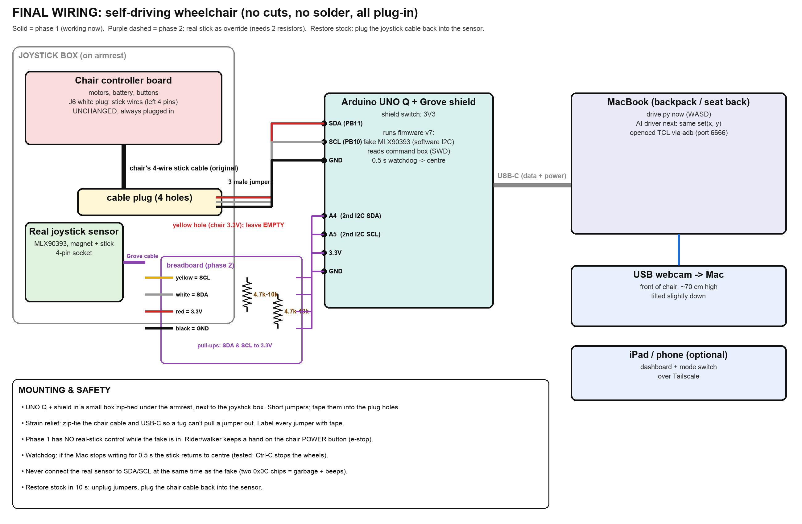

# Hardware: drive the wheelchair from code

The chair (Culver WOLF) reads its joystick from a **Melexis MLX90393** magnet sensor over I2C.
An **Arduino UNO Q** pretends to be that sensor, so the chair's own controller (motors, brakes,
speed buttons, all safety logic) stays stock. Nothing is cut or soldered.

```
laptop (teleop or the AI) --set(x,y)--> wheelchair.py --UDP over Tailscale--> wheelchaird (UNO Q Linux) --SWD 50 Hz--> MCU --I2C--> chair
                                                                                                             ^
                                                                                     real joystick sensor (Grove port D2)
```

## What's on the board
- **MCU:** `firmware/sketch.ino`. Fakes the sensor in software I2C and reads the real stick.
- **Linux:** `board/wheelchaird.py` (systemd service `wheelchaird`) takes stick commands over Tailscale and feeds the MCU.
- **Linux:** the phone/iPad service (`drive-service`), see [Phone and service](#phone-and-service).

The driving loop (camera frame -> AI -> stick command) does not run on the board. It runs in the
ml console on a laptop on the same Tailscale: see [ml/README.md](../ml/README.md).

## Wiring


- Chair's stick cable, sensor-end 4-hole plug -> shield: **red -> SDA, white -> SCL, black -> GND, yellow empty.**
- Real joystick sensor -> Grove cable -> shield port **D2** (not an I2C port).
- Shield switch on **3V3**. UNO Q powered by USB-C (a laptop or a 5V/3A power bank).
- Never connect the real sensor to SDA/SCL: two 0x0C chips on the chair's bus = garbage + beeps.
- Back to stock in 10 s: unplug the jumpers, plug the stick cable back into the sensor.

## Cold start
1. Power the UNO Q. The fake sensor starts **within ~1 s** (no Linux needed).
2. Turn the chair on (any time after the UNO Q has power). It must be quiet. If the UNO Q lost power while the
   chair was on, power-cycle the chair. Wireless control comes up ~1 min later, once Linux and Tailscale boot.

## Teleop
`python3 hardware/teleop.py`: MODE button (JOYSTICK / FSD), hold W/A/S/D in FSD.

Your computer and the board must both be on the team Tailscale (board: `wheelchair-unoq`, override with `WHEELCHAIR_HOST`).
Only one program drives at a time: close teleop before the AI drives.

## Driving from code
```python
from wheelchair import Wheelchair
chair = Wheelchair()
chair.fsd = True
chair.set(x, y)          # percent, x>0 right, y>0 forward; call at least every 0.3 s
chair.stats()            # reads, resets, sent, stick, takeover, dropout_latched, age
```
- Deadbands are handled for you (measured: forward 41%, turn 37%), so 1% = just creeping.
- **Safety:**
  - Stop calling `set()` -> stops in 0.3 s.
  - Wi-Fi gap > 0.3 s -> eases to a stop by 0.6 s. Gap > 2 s -> the real stick drives and FSD stays off until re-armed (set `fsd` again).
  - Board daemon dies -> the MCU hands control to the real stick in ~0.25 s.
  - Pushing the real stick in FSD takes over (`stats()["takeover"]`).
  - Starts ramp smoothly; stops are instant. The chair's power button is the e-stop.

## Uploading firmware
Turn the chair **off** first. On the board (adb shell or ssh), with `sketch.ino` copied to `/tmp/fw/fw.ino`:
```sh
sudo systemctl stop wheelchaird; pkill -x openocd
I=~/.arduino15/internal; L=""; for n in Arduino_RouterBridge Arduino_RPClite MsgPack DebugLog ArxTypeTraits ArxContainer; do L="$L --library $(ls -d $I/${n}_*/$n)"; done
cd /tmp/fw && arduino-cli compile -b arduino:zephyr:unoq:wait_linux_boot=no --build-path /tmp/fwbuild $L .
Z=~/.arduino15/packages/arduino/hardware/zephyr/1.1.0
cd /opt/openocd && ./bin/openocd -s /opt/openocd -f openocd_gpiod.cfg \
  -c "set filename0 $Z/firmwares/zephyr-arduino_uno_q_stm32u585xx.elf; set filename1 /tmp/fwbuild/fw.ino.elf-zsk.bin" \
  -f $Z/variants/arduino_uno_q_stm32u585xx/flash_sketch.cfg
sudo systemctl start wheelchaird
```
Do **not** use App Lab / `arduino-app-cli app start` for this sketch: it builds in "Wait for App" mode (the sensor
then only exists after Linux boots, so the chair beeps) and its boot-time re-flash fights the daemon for the SWD pins.

## Board services
Already set up on `wheelchair-unoq`. To redo it:

- Tailscale installed and logged in; Wi-Fi power saving off (`/etc/NetworkManager/conf.d/99-wifi-powersave-off.conf`).
- **No** default app (`arduino-app-cli properties set default none`), so Linux never re-flashes the MCU at boot.
- **`wheelchaird`:** copy `board/wheelchaird.py` to `/home/arduino/` and `board/wheelchaird.service` to `/etc/systemd/system/`, then enable it.
- **`drive-service`:** from the repo root on your computer, `cd web && npm run build`, then

  ```sh
  rsync -a --exclude .venv --exclude node_modules --exclude recordings --exclude .git ./ arduino@wheelchair-unoq:fsd-wheelchair/
  ```
  On the board, once:
  ```sh
  cd ~/fsd-wheelchair && python3 -m venv .venv   # sudo apt install python3-venv if this fails
  .venv/bin/pip install fastapi 'uvicorn[standard]' pydantic pydantic-settings pygeomag numpy pillow httpx websockets
  sudo cp hardware/board/drive-service.service /etc/systemd/system/
  sudo systemctl daemon-reload && sudo systemctl enable --now drive-service
  sudo tailscale serve --bg 8000
  ```
- **iPad app:** copy `app/dist` to `/home/arduino/ipad-app` (the map needs `VITE_GOOGLE_MAPS_API_KEY` in `app/.env` at build time), then
  `tailscale serve --bg --https=8443 --set-path=/api http://127.0.0.1:8000/api`, the same for `/ws`, and
  `tailscale serve --bg --https=8443 /home/arduino/ipad-app`.

Result:
- `https://wheelchair-unoq.<tailnet>.ts.net/` -> phone camera page and sensor viewer.
- `https://wheelchair-unoq.<tailnet>.ts.net:8443/` -> iPad app.

## Phone and service
1. On the iPhone (same Tailscale account), open `https://wheelchair-unoq.<tailnet>.ts.net` in Safari, tap **Chair camera**,
   then **Start streaming**. Allow camera, motion and location. Use Safari itself, not a Home Screen app.
2. Keep Safari in front and the phone on a charger. Safari stops the camera when the screen locks:
   Settings › Display & Brightness › Auto-Lock › **Never**.
3. Open the same address on another device and tap **Sensor viewer** to check the stream.

Only one phone streams at a time; a second one takes over.

To run the service on a laptop instead of the board:
```bash
brew install uv node
cd service && uv sync
cd ../web && npm install && npm run build
cd ../service && uv run python -m drive_service
tailscale serve --bg 8000        # second terminal; needs HTTPS certificates on in the Tailscale admin console
```
The phone then opens the laptop's `https://<name>.<tailnet>.ts.net` address. Wire format: [docs/phone-protocol.md](../docs/phone-protocol.md).

## Live chair metrics
`wheelchaird` writes `/dev/shm/wheelchair.json` 10x/s: who is driving, stick %, takeover, link and board health, and a
ballpark speed, turn rate and odometer (estimated from stick %, not measured).

`drive-service` on the board serves it as the `chair` field of `/api/status`, which the iPad shows. A service running on a
laptop cannot read that file; start it with
`CHAIR_METRICS_URL=https://wheelchair-unoq.<tailnet>.ts.net:8443/api/status` to copy it from the board.

## Chair dimensions (Culver WOLF, measured)
| | inches | cm |
|---|---|---|
| Overall length | 40 | 101.6 |
| Overall width | 25 | 63.5 |
| Rear (drive) wheel diameter | 12 | 30.5 |
| Front (caster) wheel diameter | 7 | 17.8 |
